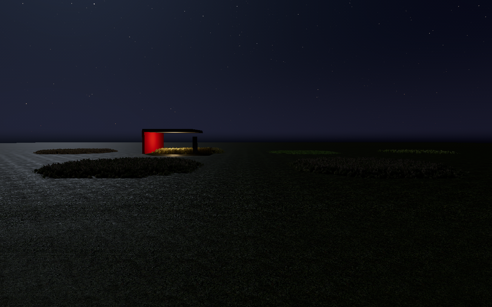

# Approved stock foliage integration, 24 November 2026

The five accepted temperate plants now join the three meadow choices in Terrain > Vegetation. The picker has nine entries including Custom and displays them without requiring scrolling. Source art is unchanged: seven 1024-by-1536 RGBA sheets, each with six 512-square source cells and the approved native crop rectangles.

## Behaviour

Choosing a stock plant changes only the brush. Stock planting adds a separate species without clearing existing plants under the stroke. Each stock choice has its own dimensions, density and simulation/detail settings across the terrain. Its slider edits and Undo/Redo affect that choice only. Full and Very Full use separate versioned project identities despite sharing one PNG.

Native hair geometry, materials, masks and layer density are saved in WISCENE. Terrain metadata stores per-choice settings, including edits made before the first stroke. Ground Grass Coverage uses the layer's own density when hiding and restoring vegetation. Custom and legacy controls retain their shared workflow and skip the new independent stock layers. Custom painting retains its previous replacement semantics. Erasing affects all species under the brush.

Older meadow layers retain their existing native appearance and shared settings. They are not automatically migrated. Stock adoption verifies the original SHA-256 and publishes a project-owned versioned PNG transactionally. Packaging copies the seven approved files and retires only the thirty named obsolete stock files, retaining unrelated install files and project Custom/Mixes resources.

See MEADOW_GRASS_PRESETS.md for the eight height/density defaults. Native geometry, six crops, colour, alpha clip, roughness, reflectance and emissive strength match the approved review. Direct comparison caught inherited drag/gravity defaults of 0.1/0 instead of the accepted 0.12/0.02; both are corrected for stock choices. The source approved night WISCENE remains byte-identical (SHA-256 798a180b7c74c897fb4bccd743dd123ccf92b92e80d419d78c31e7123db120e9).

## Local verification

Windows x64 Release compiled VegetationService, GroundPaint, WD01Vegetation, the registered native proof and review tools against the existing matching dependency/object cache. It linked the isolated editor and UI controllers. This is not a clean whole-configuration build.

Successful commands in the existing owner foliage QA workspace include:

    build-integrated-stock.cmd
    link-integrated-stock.cmd
    Integration/build-integrated-ui.cmd
    Integration/verify-established-player.py
    Integration/build-painter-review.cmd
    Integration/build-owner-startup.cmd
    Integration/verify-painter-launcher.py
    Integration/final-picker-build.cmd

The native sections and UI section of Integration/final-validation.py pass. Its initial combined run subsequently timed out waiting for a capture from an alternate Runtime relinked from a different cached application object set. That relink is not accepted as player evidence. The established staged normal Runtime successfully cold-loaded and captured both the actual painter result and the approved night reference. Its receipts are retained separately. Controllers terminate only their own isolated player tests; these captures establish startup/presentation at frame 60, not converged GI or clean exit.

The registered grass-palette proof now includes Tests/StockPlantProfilesProof.h. It verifies all eight overlapping choices, deterministic adoption, geometry/material defaults, independent Full/Very Full identities, stock paint Undo/Redo, clover-only edits with settings history, isolation from Custom settings, ground coverage suppression/restoration, all-species erasing/history and cold reopen/native updates. The existing Custom sheet/mix, GPU variety, cursor/player response and steady-walk checks also pass. The separate ground-paint regression passes live-frame writeback, import, soft edges, erasing, grass coverage, history and reopen.

The disposable editor controller exercises each actual preset selector and slider callback, then Undo/Redo, checks shared terrain values remain unchanged, and verifies returning to a Custom thumbnail. It reports STOCK_EIGHT_PLANT_UI_SCOPED_SETTINGS_CUSTOM_PASS. The last picker adjustment only increases the native visible-item limit to nine and compiles/relinks successfully; it adds no new input path.

Tools/FoliageNightReferenceVerify.cpp accepts an optional painted scene. Its six-species comparison passes for the accepted broad meadow and five additions, checking geometry, dynamics, colour/material and every crop rectangle against the preserved reference. Its original reference integrity and GI-off negative control still pass.

## Actual painter views and wind

Tools/StockPlantPainterReview.cpp paints eight separate native terrain plots using the production bridge, saves/reopens the scene, and restores the approved night GI. It uses SceneService and normal initial native frames so terrain identity and resources are ready. Early raw-archive harness attempts lacked this lifecycle: initial paint requests were rejected and a later raw capture had untextured terrain. Those attempts are retained locally and are not accepted visual evidence. The completed lifecycle run has textured terrain and was inspected.

The review uses native breeze direction (0.08,0,0), speed 1 and randomness 5. Actual native position-buffer spans change for all eight stock choices; the test reads position spans rather than a whole-buffer counter/hash. This establishes movement under those conditions, not universal stutter/shimmer acceptance. The saved plot counts are 3449, 1724, 3449, 1724, 1724, 1035, 1380 and 276. Native terrain sampling and float truncation explain the slight differences from nominal area counts.

The completed run captures the prepaint reference, eight nighttime close-ups, night overview/25 m/60 m and noon overview/25 m/60 m. Near and distant captures were inspected for plants, coverage, texture loading and light response. The noon views use exposure 1 and GI off; night uses the approved exposure 3 and Surfel GI. These are static geometry/lighting views, not matched-exposure GI comparisons or a temporal anti-aliasing certification. The earlier controlled GI report remains the paired-lighting evidence.

## Owner review and remaining gates

The owner confirmed the previously open approved night scene plays well at 75 FPS. It was closed gracefully for sequential GPU verification and restored afterward; the importer session was not touched. That statement is scoped to the owner-tested reference, not a whole-level benchmark for the new palette.

The Desktop Foliage Painter Studio launcher opens the separate editable eight-plot review in Terrain > Vegetation. It reuses the existing editor with a review-only startup controller; that controller only opens the private project, selects the workspace and frames the scene. It does not run widget/painting tests during owner use and is not shipping production source. Its exact launcher/project readiness was verified on an isolated desktop. Its Runtime support is staged alongside the editor. An initial plain cached-editor startup route did not report/open the desired project and was replaced with this explicit review startup. The launcher closes only the known foliage preview before opening the editor, avoiding another concurrent foliage renderer. It does not close importer work.

Evidence is in evidence/stock-plants-2026-11-24. Full images, scripts, response files, diagnostic failures and review projects remain in the owner QA workspace. No upstream, shader, global lighting/default weather, importer or zone changes were made. No push, merge, hosted CI, independent exact-commit review, game export or release gate closure is claimed. Full Debug/Release configuration checks and owner interaction/distance/performance review remain before release. Automatic world moonlight tracking is separate follow-up work.
