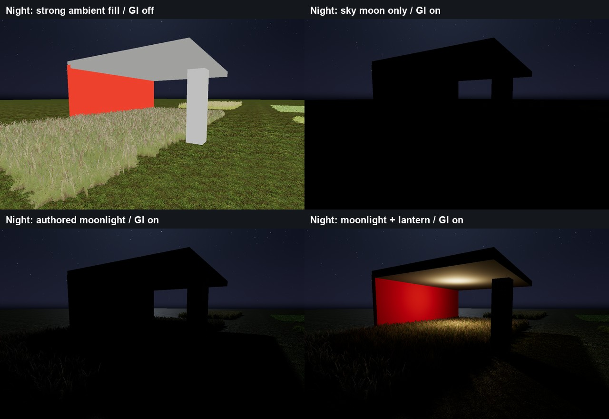

# Foliage and terrain: night lighting and GI, 24 November 2026

The owner asked to test the accepted meadow and five temperate additions with
global illumination, especially nighttime and the moon's influence.

The grass and terrain respond to direct lighting, shadows and Surfel GI in this
fixture. Both become essentially black when illumination is removed. The main
nighttime concerns are the lighting setup: the artwork review has strong fixed
ambient fill, and the visible sky moon does not automatically create a world
directional light.

## Findings

1. **No persistent grass self-glow was observed.** The no-light control produces
   roughly 0.25/255 mean display luma in both selected ground and grass regions,
   including the normal low-level output dithering. This is effectively black,
   not evidence of emissive grass. Foliage materials and artwork were unchanged.

2. **The original review's fixed ambient is 0.75 per RGB channel.** Its realistic
   sky was disabled for artwork review. Carrying that fill into midnight leaves
   both plants and terrain bright. The same nighttime fill with Surfel GI on
   drops strongly as the GI solution replaces flat indirect lighting. Do not
   treat this private artwork fixture as the default lighting of every project.

3. **The sky moon and world moonlight are separate authoring controls.**
   MoonService stores lunar appearance/orbit fields on Weather; it does not
   create a directional LightComponent. Full/new/off sky-moon tests provided no
   useful ground illumination in this level, including the paired Surfel GI
   cases. Existing Cold Moonlight can be authored as a separate directional
   light; that preset lights and shadows both the terrain and grass.

4. **Direct moonlight and local lights work on the accepted plants.**
   The authored moonlight uses the existing preset colour (0.56,0.69,1) and
   intensity 0.5, aligned with the visible moon at azimuth -35/elevation 35.
   The separate warm lantern has intensity 12, range 10 and shadows enabled.
   The shelter blocks directional illumination across both vegetation and
   ground; the lantern lights its grass and interior.

5. **Surfel GI has a visible effect; SSGI is more limited in this fixture.**
   At exposure 1 the selected sheltered grass/gap region changes by about
   4.40/255 mean absolute RGB between lantern GI-off and Surfel GI-on, versus
   0.026/255 for the SSGI comparison. Daylight shade also changes with Surfel GI.
   GI resources and applied render settings were checked, rather than counting
   a toggle alone as proof. These screen regions contain some gaps/ground and
   are not measurements of isolated blade radiance.

The current setup therefore needs low nighttime ambient and an authored
moonlight to obtain a controllable moonlit world. Automatically linking the
world light to moon position, phase and brightness is follow-up engine work;
it was not implemented or silently simulated by these tests.

## Controlled study

Tools/FoliageLightingReview.cpp creates a copy of the accepted six-plot scene
for each case. It keeps the approved PNGs, material calibration, densities,
heights, terrain, camera and shelter geometry fixed. The shelter has a neutral
roof, red diffuse bounce wall and neutral post. Self-lit review labels are
removed so they cannot contaminate darkness or GI.

Realistic sky is enabled for the lighting study. Sun time uses SunService.
Moon and night appearance use the existing serialized MoonService/NightSky
controls. The additional directional moonlight is explicitly named as an
authored preset, with the Sun retained first as the sky's primary light.

Wind is frozen to compare stationary lighting images. Eye adaptation, bloom,
depth of field and motion blur are disabled. AA remains Off. The first 13 cases
use exposure setting 1 throughout. Eight follow-up nighttime cases use exposure
setting 3 throughout to make the playable night review easier to inspect.
GI on/off pairs always have matching exposure and lighting.

| Initial cases, exposure 1 | Follow-up cases, exposure 3 |
|---|---|
| Day, GI off and Surfel on | Strong inherited ambient, GI off and Surfel on |
| Dusk, GI off | Moon off and full sky moon, Surfel on |
| Midnight with inherited ambient | Authored moonlight, GI off and Surfel on |
| Midnight, moon off/full/new, GI off | Authored moonlight + lantern, GI off and Surfel on |
| Authored moonlight, GI off and Surfel on | |
| Moonlight + lantern, GI off/Surfel/SSGI | |
| Zero-light control | |

Each of the 21 configurations is saved and cold reopened. The check validates
six plant layers and native terrain, unchanged strand counts, persisted GI and
exposure settings, moon enabled state, expected light count and actual GI
resources. NightSky runtime fields are restored from serialized metadata before
rendering. Non-GI views warm for 150 frames; GI views warm for 360, with another
120-frame shelter capture to retain a later convergence sample. This yielded
51 native captures from two fixed camera positions.

Representative means from the exposure-1 overview, in display luma out of 255:

| Condition | Exposed terrain | Short-grass region, including gaps |
|---|---:|---:|
| Day, GI off | 94.42 | 140.67 |
| Night, no moon | 0.25 | 0.25 |
| Night, authored moonlight | 4.04 | 2.49 |
| Zero-light control | 0.25 | 0.25 |

These are tonemapped image measurements, not physical illuminance or linear
radiance. Different albedos do not imply grass and ground should have equal
brightness. Regions were chosen from the fixed images; their rectangles and
complete RGB means are retained with the evidence.

## Verification and reproduction

Windows x64 Release compiled and linked the native author against the existing
matching dependency/object cache. The relevant native Scene, RenderPath3D,
Renderer and component headers matched between the compiler header tree and
linked dependency tree.

The first compile had an incorrect capitalization of a diagnostic resource
member. It was corrected. An initial exposure-4 follow-up failed its expected
value check because RenderSettingsService correctly clamps exposure to 3.
That failed fixture is retained separately; the completed follow-up uses the
supported value 3. Neither failure was a grass, GI, or persistence regression.

Successful local commands/logs are retained in the existing foliage QA workspace:

    build-lighting-review.cmd
    build-lighting-followup.cmd
    summarize-lighting.py
    verify-lighting-runtime.py

The general native invocation, requiring a fresh output directory, is:

    FoliageLightingReview.exe <accepted-scene.wiscene> <fresh-output-directory>

Append a case name to select one case, or followup to select exposure-3 cases.
Both completed matrix logs end with:

    FOLIAGE_LIGHTING_SAVE_REOPEN_NATIVE_CAPTURE_PASS

Three unmodified normal Runtime processes opened separately identified projects
for daylight/Surfel, authored moonlight/Surfel, and moonlight+lantern/Surfel on
an isolated Windows desktop. All captured the actual player camera at frame 60
and stayed alive afterward. Those captures were inspected. The controller then
terminated only its own test processes; clean shutdown was not verified by that
check. Frame-60 captures establish startup/presentation, not a fully converged
GI comparison; the longer native runs supply the paired lighting evidence.

Eight private playable projects have fresh project and scene identities. The
Desktop Foliage Lighting Review folder supplies labelled launchers. Close a
review before opening another. The night moonlight+lantern/Surfel case was opened
for the owner, with the previous foliage review closed gracefully. Its frames
advanced while unpaused. The unrelated importer Test Game was preserved.

Evidence is in evidence/foliage-lighting-2026-11-24: image-regions.json,
region-means.csv, pair-differences.json, both native receipts, Runtime receipts
and the unedited-image comparison montage. Complete source captures and local
reproduction scripts remain with the owner QA projects.

No production shader, lighting defaults, upstream pointer, importer, zone or
stock foliage palette changed. The study is not a whole-level performance
benchmark, clean Debug/Release build, hosted CI result or independent release
sign-off. It does not certify DDGI, VXGI, all ray-traced modes or GI during a
continuous day/night transition.

## Owner-approved night reference

The owner approved the live moonlight + lantern + Surfel GI appearance.
`Examples/FoliageNightReference` preserves the byte-identical approved scene,
fresh project/scene identities, file hashes, settings and reference images.
`FoliageNightReferenceVerify` cold-loads it, validates the six embedded foliage
atlases, plants/materials and lighting settings, and passes. The GI-off negative
control is rejected with exit 1. Its first diagnostic incorrectly required CPU
file bytes to remain retained: uncompressed native archives can lazily stream
embedded resources without retaining that vector. The corrected check inspects
the archive resource table and loaded textures.

The reference was moved into the repository example and cold-loaded by the
unmodified normal Runtime on an isolated desktop; its player capture was
visually inspected against the original. Reference receipt JSON retains image
differences. Native WISCENE bytes are unchanged: no material/path rewrite or
terrain virtual-texture repack was applied. The Desktop launcher is
`Approved Night Reference.cmd`; close the current review before opening it.

The owner reported a large FPS drop during this work. A second Runtime was
briefly active for the relocated-reference check and has exited. This may have
caused GPU contention; causation/recovery is not established. No additional GPU
tests were started afterward. The approved visual reference does not constitute
performance acceptance. The live review and unrelated importer test are retained.

The original and relocated startup captures use different player view directions;
the retained RGB difference is not a pixel-parity result. Both show the expected
foliage, terrain and illumination. Exact saved-state preservation is established
by the unchanged archive hash and the native resource/settings checks. The later
FPS sample was approximately 75.8 submitted frames/s while paused and unfocused;
it does not establish recovered interactive presentation FPS.
