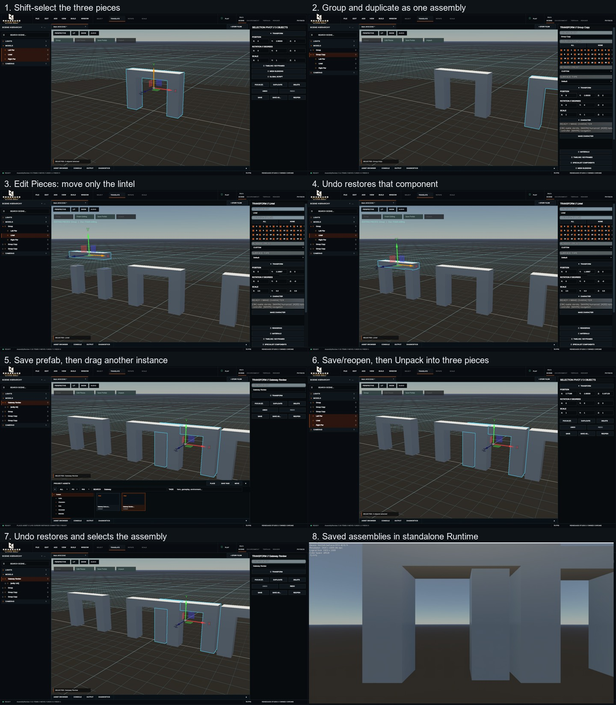
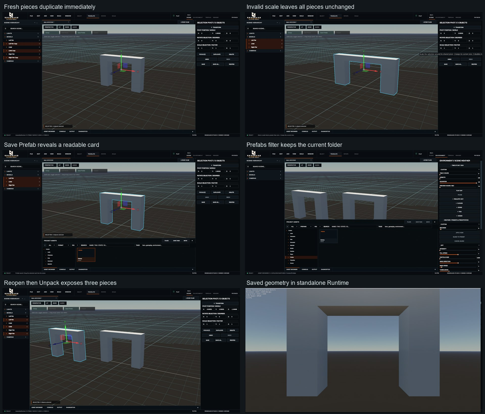

# Editor multi-selection and scene prefabs

Status: first assembly workflow accepted by the owner on 10 November 2026 at 110b6a6.
The owner accepted usability. Full functional prefab content support remains required and unfinished.
The first acceptance gate is one small real assembly, before wider feature work.

## Required demonstration

Select three pieces -> Group -> Duplicate -> Edit Pieces -> change one component ->
Undo -> Finish Editing -> Save Prefab -> place a second instance -> Save/Reopen ->
Unpack. Verify the same assembled geometry and materials in the standalone Runtime.

The fixture is a stone gateway made from two piers and a lintel. It contains no
castle-kit content. Existing owner projects are not a test fixture.

## Creator interaction

- Click selects one object. Shift + click toggles membership, in both viewport
  and hierarchy. Clicking another object replaces the selection.
- Drag from empty viewport space to box-select. Left-to-right selects fully
  enclosed objects; right-to-left selects intersecting objects. Shift adds.
  Right/middle mouse navigation and active terrain/river authoring keep ownership
  of their existing gestures. Escape cancels an in-progress selection box.
- The native move, rotate and scale gizmos operate around one shared selection
  pivot. Selected descendants of a selected parent are excluded from the native
  transform list, so they cannot move twice.
- The multi-selection Inspector shows the selection pivot. Position is an
  absolute pivot location; rotation and scale apply a delta/factor to the set.
  A fresh rotation value of zero or scale factor of one is neutral.
- Visible viewport actions: Group, Edit Pieces, Save Prefab and Unpack.
  The same actions are available from Edit. Ctrl+G groups; Ctrl+Shift+G unpacks.
- A group is selected as one unit. Edit Pieces enters that group. Click a piece
  or choose it in the hierarchy to edit it. The editing banner stays visible;
  Finish Editing or Escape returns to the group. Choosing an unrelated object
  leaves piece-editing mode.
- Duplicate and Delete act on the selected roots as one history operation.
  Undo/Redo uses the existing CommandService. Group and Unpack preserve world
  placement and restore the old hierarchy when undone.
- Save Prefab asks for a name and states its destination: Content/Prefabs.
  It creates a new reusable copy. Existing names are rejected without overwriting.
  Place copies using the ordinary Asset Browser. Each placed instance is
  independently editable; this first workflow does not propagate source edits.
- Unpack exposes the actual component objects. Internal placement wrappers do
  not become extra manual unpack steps.

## Reused foundations and boundaries

SelectionService retains its existing single-selection accessors and adds the
ordered set, toggling, membership and revision. Studio's Inspector can retain an
active entity while transform/history operations consume the complete selection.

The existing Wicked Translator provides the shared pivot and native manipulation.
Renegade adds atomic batch history and hierarchy-safe root filtering. Selection
outline discovery runs when selection changes, not every frame.

Groups are ordinary native scene transform parents with versioned Renegade
metadata. SceneAssemblyCommand captures the old parents/local transforms, and
keeps the group persistent identity across Undo/Redo. Unpack restores those
relationships symmetrically.

Scene prefabs use the existing .rasset manifest, project registry/provenance,
managed projection, dependency staging and ProjectDocumentTransaction. Their
source format is scene-assembly, importer renegade.scene.assembly, recipe schema 1.
Native scene serialization retains component state. A shared native entity remap
copies the selected hierarchy and follows mesh/material/animation-data references
to closure. References to authored objects outside the selection fail explicitly.
Embedded resource data travels with the saved native payload.

The ordinary placement command and live-drag adoption path mark the same single
editable group boundary. Nested imported model roots cannot displace the outer
prefab root during placement. The standalone Runtime consumes the normal native
scene hierarchy; there is no editor-only geometry reconstruction step.

Terrain, river spline controls and waterfall handles keep their accepted exclusive
authoring selection and transaction paths. This grouping prototype must not
bypass linked-terrain safety limits.

## Scope of the first gate

The initial demonstration covers native scene components, geometry, component
transforms and materials. Linked source updates, prefab overrides, nested prefab
authoring UI and companion-document scripting templates are not established by
this gate. Do not claim broader prefab support from a static geometry proof.

Do not merge main, modify castle assets or distribute a build without owner
approval. Preserve the separate light/particle work and all uncommitted content.

## Verification

Build the isolated Windows Release Studio, Runtime and
RenegadeSceneAssemblyWorkflowProof.

Run RenegadeSceneAssemblyWorkflowProof --core for CPU-safe identity, hierarchy,
selection and rollback checks. Run the same executable with a new output folder
on a real Windows graphics device for the full native geometry/prefab workflow.
The generated review project supports the actual Studio interaction trial.

Automated success does not establish usability. The exact native interaction
sequence and visual result must also be demonstrated and reviewed.

## Recorded local demonstration - 10 November 2026

The actual Studio trial used the generated AssemblyReview project: Shift-selected
the left pier, right pier and lintel; toggled a component through the hierarchy;
grouped; duplicated and moved the group; entered Edit Pieces; raised the lintel;
and undid that component edit. Save Prefab created Gateway Demo / Gateway Review
in Content/Prefabs. The review project contains only the gateway fixture.

Dragging Gateway Review from the real Asset Browser created another editable
assembly. Saved Main.wiscene, used Reopen, selected the placed instance, then used
one Unpack. The hierarchy exposed exactly Left Pier, Lintel and Right Pier.
Undo restored and selected Gateway Review; Redo restored all three selected pieces.
Finally undid Unpack and saved, leaving a packed instance for review and Runtime.

The initial drag trial exposed native Instantiate's extra structural root.
Placement now recognises it; Unpack traverses both internal containers. A native
regression creates the actual Instantiate/adoption hierarchy, verifies exactly
three unpacked pieces, and checks Undo/Redo without geometry loss.

Launched the separate RenegadeRuntime.exe with the saved .renegade project and
normal startup Flow. Its spectator view rendered the saved gateways at 75 FPS
(VSync limited on this machine). This is a geometry/persistence check, not a
performance benchmark, collision test or playable-character acceptance.

Evidence: the adjacent individual PNGs, native-workflow.log and Studio/Runtime
diagnostic snapshots. The Studio snapshot records SaveScene, ReopenScene,
UnpackGroup, Undo, Redo, Undo and SaveScene. Snapshot build_commit reports the
base commit because these local candidate changes were built before checkpointing.

Validation: Windows Release Studio/Runtime/proof build; full native workflow
including three material colours and shared donor-resource exclusion; 3/3 targeted
CTest checks (core history, marker selection routing, point lookup). Hosted
Debug/Release CI and independent review have not been run for this branch.

Usability remains an owner acceptance gate. Browser cards currently use the
existing generic file presentation rather than a captured prefab thumbnail.
The successful save/reveal path accepts that card without issuing a misleading
thumbnail error. Linked updates, overrides and broader prefab features stay
outside this gate.

## Selection usability follow-up

The accepted workflow stays intact. Single-target actions Edit Pieces and Unpack
require one selected assembly; selecting several no longer quietly edits only the
last group. The viewport explains Shift toggling and empty-space box selection.
A live box hint names containment/crossing and the additive/cancel behaviour.

Left-to-right containment evaluates each complete assembly's projected bounds.
Enclosing only a pier no longer selects a larger assembly outside the box.
Crossing selection can still catch part of an assembly. Group-bound aggregation
uses an operation-local index and runs only when the box is released.

Numeric multi-selection labels distinguish world pivot position, rotation in
degrees and scale factor. 0 rotation and factor 1 are neutral. World-space edits
and atomic history are prepared through SceneAssemblyService; invalid scale or
unrepresentable parent shear fails before any selected object changes.

The Asset Browser offers PREFABS in its format filter and marks saved scene
assemblies as PREFAB with a readable extension-free name. This pass does not add
linked-source behaviour or change the accepted Save/Place/Unpack interaction.

## Follow-up local evidence - 10 November 2026

Fresh unsaved pieces now duplicate immediately, including when the real Studio
script companion hooks are installed. Previously those hooks rejected missing saved
IDs before discovering there were no script attachments. The graphics proof covers
both default and Studio hooks; strict identity validation remains for scripts.

The actual Studio pass exercised multi-object move/rotate/scale, invalid-scale
rejection, Duplicate/Delete with selection restored through Undo/Redo, and Undo
leaving Edit Pieces safely. Containment around only one pier excludes the whole
group; crossing catches it. Multi-group Unpack reports a clear single-target hint.

Save Prefab opens a clean modal and reveals the new PREFAB card automatically.
Selecting a source pier does not highlight another placed instance. The PREFABS
filter retains the current folder; its dropdown no longer clicks folders below.
The final fixture saves separate source pieces and one placed Gateway instance.
Save/Reopen preserves both; box selection finds three source pieces, one Unpack
exposes exactly three prefab pieces, and Undo restores the selected Gateway.
Standalone Runtime renders the saved geometry through normal spectator startup.

Windows Release Studio/Runtime/native proof builds passed. The full native graphics
proof and 5/5 targeted CTest checks passed; see adjacent logs, diagnostic snapshots,
and source/binary hash manifest. The candidate was built before checkpointing, so
its embedded commit string remains the accepted parent. New owner acceptance,
hosted Debug/Release CI and independent exact-commit review remain pending.
No linked updates, overrides, scripting-template, collision, packaged-build or
playable-character acceptance is claimed from this small geometry fixture.

## Current main integration

The feature branch integrates light/particle main 6036b20 after owner instruction.
Ordered selection normalizes internal particle layers at its shared bridge boundary,
including set and toggle operations. Geometry prefab workflow and ten focused checks
pass locally; Studio shows both pickers alongside the accepted prefab interaction.
See evidence/selection-prefab-integration/ and HANDOFF for commands and source hashes.

This is an integration checkpoint. General prefab completion requires a functional
assembly carrying light behaviour, complete layered particles, script properties
and internal entity references, supported material/shader resources and dependencies.
The next proof is a working brazier through independent placement, Duplicate/Delete
Undo/Redo, component editing, cold reopen, unpack and standalone Runtime. Existing
CI covers the earlier isolated geometry checkpoint and cannot close this requirement.
