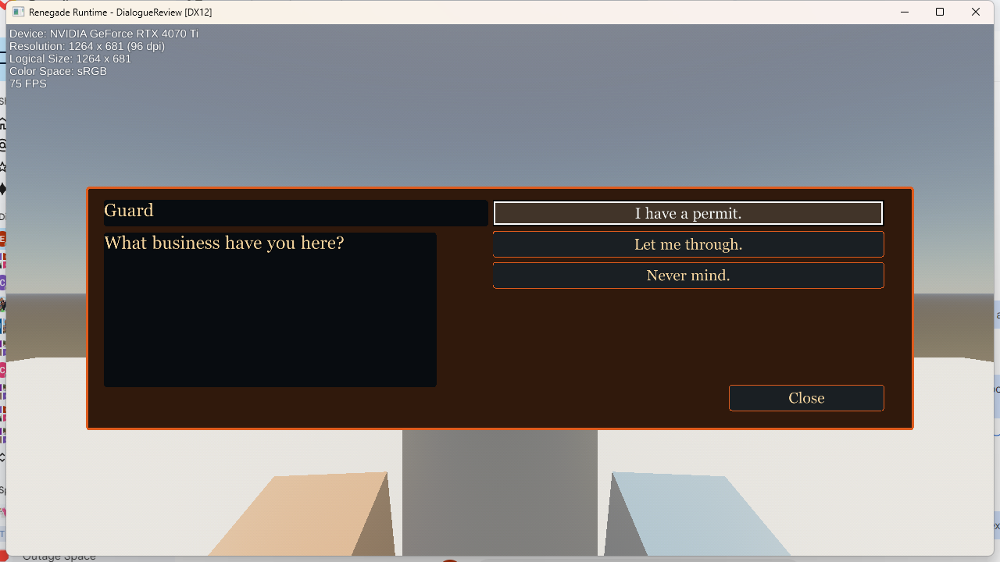
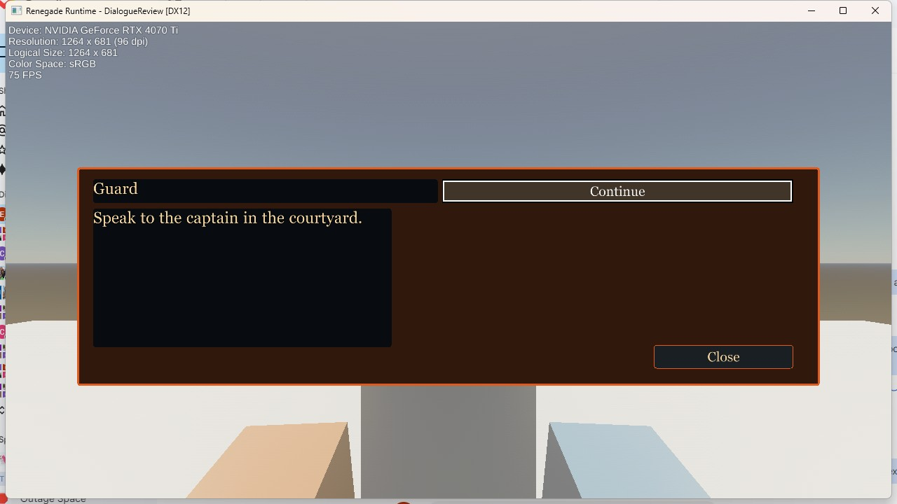
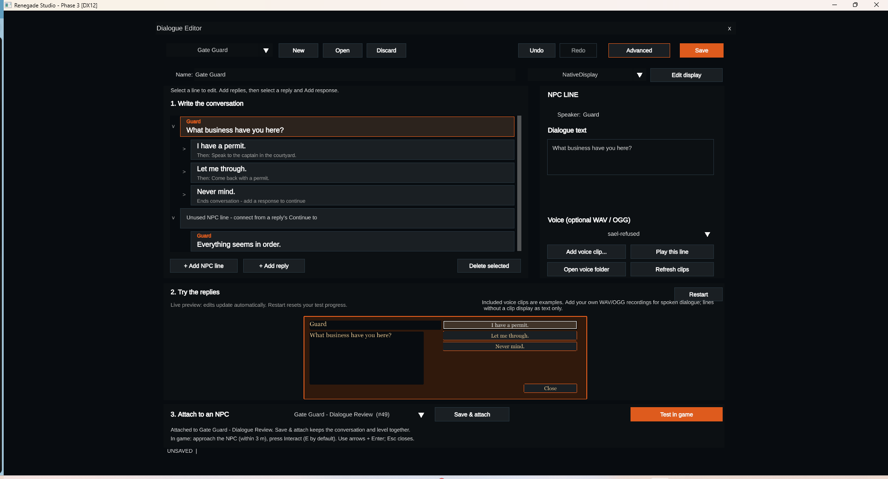

# Editable dialogue displays - local receipt

Display implementation baseline: `4e8f1fa44c565411d00ccc2f494ceb6cb9de7927`.
The later Advanced-selection correction is Studio source
`d38d23eafc7e38c8a86b3ee7fec59d2ff98b2e58`; it built and passed five focused
dialogue suites. Its automatic first-reply selection still needs native owner
review because the active older session contains unsaved edits.
Release Runtime and the normal RenegadeStudio.exe built successfully.
14 focused CTest suites passed in **7.61 seconds** after the final build.
Commands and changed files are recorded in HANDOFF.md.
Studio SHA-256 at the display baseline (normal and refreshed review binary):
`7DB712A5C85BA6A91657573E96B96E117E05C133ADC70EF80AD1EAE6F6A46F88`.

## Coverage

DialogueDisplayTests exercises the production Screen codec, authoring session,
assignment, adapter and snapshot implementation: all roles, renamed elements,
custom font/colour/geometry preservation, pages of replies, Continue/Close,
Undo/save/reload, foreign identity rejection, invalid/missing roles, hidden
parents, font/image dependency staging and missing-resource failure.

The other focused suites cover dialogue core/assets/save policy and scripting,
governed Lua/source contract, Screen authoring/history/completion and renderer,
Runtime Screens, Test Level snapshots including native reload and game save slots.
No broad performance or independent release-gate acceptance is inferred.

## Native observations

At `68c7dcc`, a disposable copy of the guard project ran in the actual Runtime.
Its assigned full-artboard display used a project Georgia font, gold text, a brown
opaque background, different dimensions and a different screen position.
Enter activated the first reply and correctly advanced work -> captain, played
the matching Sael clip and presented Continue. Text-only operation is unchanged.
The original owner project and its dialogue connections were preserved.

At `2de8dff`, Add > Dialogue Editor displayed the selected NativeDisplay and Edit
display opened the normal UI editor through the new handoff. Layers, the full
design canvas, current dialogue role and project font controls were inspected.
The owner responded "this looks good" to the shown direction. This is visual
approval, not permission for a PR, CI, merge or release.

Input automation stopped when the owner began using another foreground window.
The final mouse-driven Apply/save/Back round trip was therefore not completed;
automated save/reload and native authoring-session checks passed. The owner subsequently returned to the conversation workspace and reported the
NPC LINE overlap. The review executable was refreshed from the final normal
Studio executable so both are now identical. The refreshed live window was visually checked: NPC LINE and
the display selector are clear; the note is above the conversation preview.

Owner/independent workflow review remains scoped accordingly.

## Preserved corrections and limits

Native review exposed the old example-audio note overlapping first the new
display controls, then the selection heading. The final source places it in the
preview caption area. Conversation preview is a close-up; Runtime and the UI
editor use the complete authored artboard. Display selection updates explicit
packaging roots and removes the previous assignment's root. Back is labelled
generically because the Screen editor can return to either dialogue or Flow.

Missing custom resources or renderer rejection fall back to the built-in display
at runtime; Test Game staging rejects incomplete assets for creator repair.
No new packaged distribution or universal platform/performance proof is claimed.
All changes remain local on the isolated dialogue branch; Wicked is unchanged.
