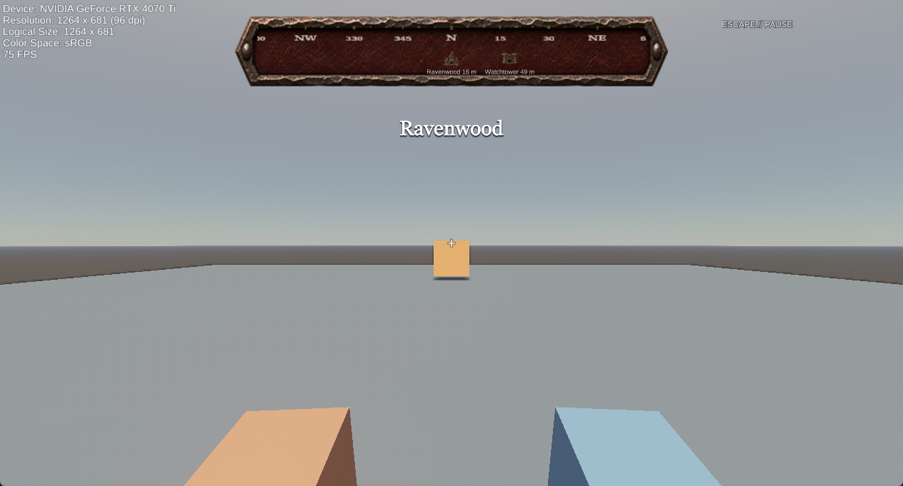
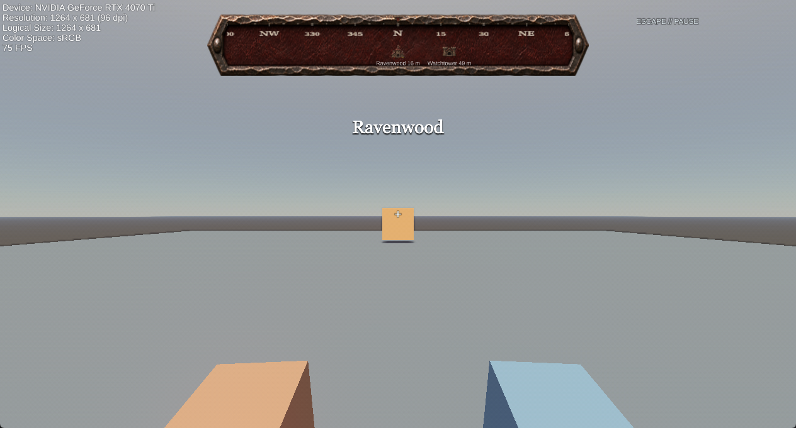
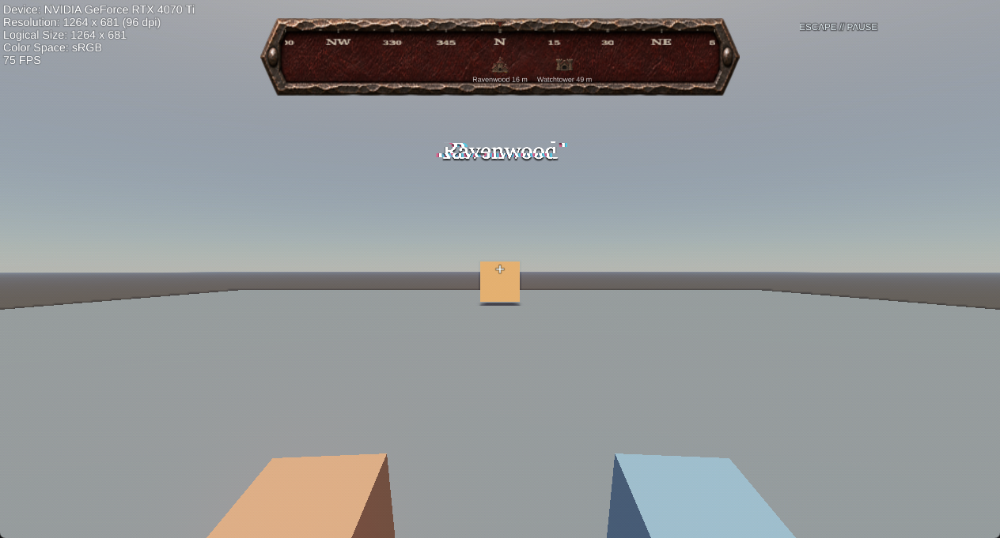

# Location text effects and font picker: local evidence

27 November 2026, Windows x64 DX12 Release, RTX 4070 Ti. These are captured native Runtime frames, not mockups. The isolated review uses the existing Starter level/HUD and a governed Level script that announces Ravenwood with a project-owned imported Georgia TrueType font, then switches through wobble, glitch and fade.

- Wrapped/centred wobble: full-opacity glyph top moved by 22 native pixels between captured frames, with a review strength of 12. The font parameters' offset was previously discarded by wrapped layout. Both wrapped and unwrapped drawing now apply the same offset after alignment.
- Glitch: a captured burst contains 363 red/cyan fringe pixels in the text region. Short opposing horizontal cuts replace whole-line jitter/flicker; intervening frames show clean text.
- Fade: the capture shows glyph visibility rising from background to full text and returning to background. The opacity envelope now uses smoothstep easing.
- Font: Georgia was imported through CreatorScreenFontImportService into the isolated project and rendered by the actual announcement layer. The final Studio Location Zone Inspector also imported and selected Georgia through the native font picker. Choices show TrueType full names, with a short asset suffix to distinguish imports.
- The normal Studio executable was rebuilt/installed, the existing review scene saved and reopened, and Ravenwood's saved name/range/timing settings restored. The picker/import was checked on that reopened scene. The selected custom font was then saved with the scene. Native Undo/Redo was not counted as an acceptance result because editing continued during the check; automated zone edit/Undo/reload contracts cover the setting.
- Studio remains open for owner testing. No hosted CI, push, PR or independent release gate was run.

## Reproduce

Build EngineBridge, ScreenRenderer, RuntimeBootstrap, Runtime, Studio and WorldLocationTests in Release/x64. The local no-project-reference build explicitly recompiled consumers of LocationAnnouncement.h and StudioApplication.h; otherwise stale compiled object layouts can survive a successful link.

Copy a disposable project into a directory named Location FX Review. Run RenegadeWorldLocationTests --fx-review <descriptor> <TrueType-file>. This creates an isolated governed Level script and imported font; it refuses other directory names. Configure that disposable descriptor for direct Starter scene startup, then launch the normal Runtime with --project <descriptor>. The review script announces wobble for four seconds, then glitch and fade in five-second slots. Production announcement settings remain authored by each Location Zone.

## Checks

Release builds pass for EngineBridge, ScreenRenderer, RuntimeBootstrap, Studio review and normal installed executable, Runtime, WorldLocationTests, ScreenRendererTests, GameplayZoneTests and WorldNavigationTests. WorldLocationTests covers font metadata/history/WISCENE roundtrip, typed Font dependency, rejected unsafe/non-font paths, actual Lua get/configure including EntityRef, smooth fades, bounded glitch bands and reduced motion. MarkerIcons, Phase5Gate3, EditorPointLookup, StudioUiPolicy and the complete AssistantWorkflowSuite pass.

Discovery remains per Level visit. Gameplay minimap, persistent discovery and cross-project scene-prefab resource remapping remain outside this change.
