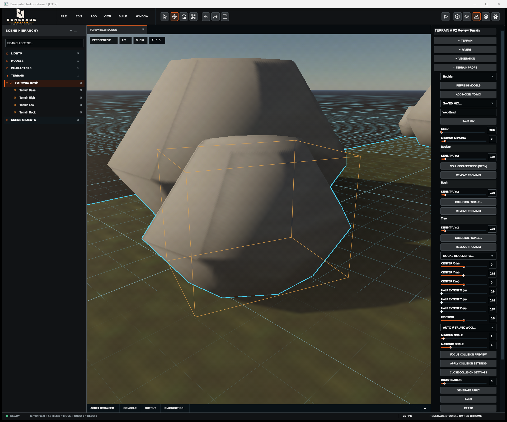
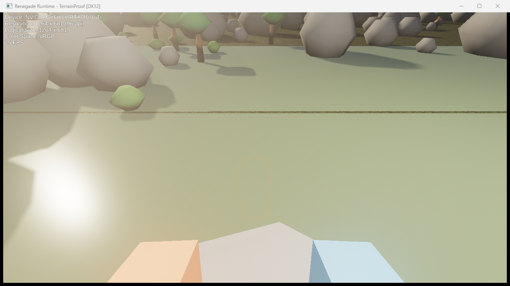
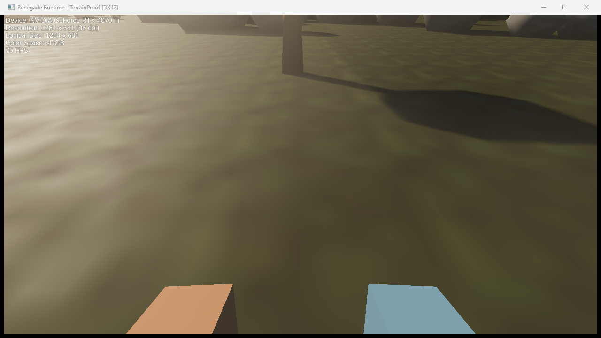

# Terrain props P3: local collision/gameplay evidence

Implementation: `9989b3f1599781c26d7ee5c62287919348976295`; independent Runtime scene-transition fixture link correction: `ed959f9f1aeea98e2311ffd4cd8e8183e367f089`. The product C++ in these native binaries matches that validation commit. The final publication also contains the four source contracts and opt-in river-test diagnostics identified by SHA-256 in `validation.json`. Documentation/publication commit identity is available with `git log -1 --format=%H -- HANDOFF.md`.

Baseline is merged P2 PR #198 at `38196e9869fabd36c9255c64cd248d1000b68285`. Wicked remains `82557d439a41d104f559b0d3134d160b7bf6154e`; imnodes remains `eb36902c892548ef94f88f51ad7e7c9c7058a71c`. The ten preexisting configuration overlays were checked byte-for-byte and preserved uncommitted.

## Check results

| Check | Result |
| --- | --- |
| Release unfiltered CTest | 344/344 PASS; 559.28 seconds |
| Debug registered test set | 328/329 initial full run; sole timing failure passed 10/10 rechecks; all 329 unique cases verified |
| Studio and Runtime packages | Both configurations PASS; LP05 and LC01 subprocess proofs PASS |
| Constructor startup smoke | Debug and Release exit 0 |
| WARP / renderer overlay | 4/4 PASS; unchanged overlay timeout |
| Matched hosted depth | Debug/Release Edit and Release Slice exit 0 |
| Native editor / separate player | Both inspector widths and player PASS; inspected real captures; normal close exits 0 |

Debug's unfiltered invocation passed 328/329. The sole failure was the unchanged TestLevelRuntimeProcessTests 250 ms deferred-launch assertion. It passed ten immediate repeats, then ten repeats with hash-identical parent/child fixtures on fast scratch. The continuation verifies every original result row and the ten-pass recheck, preserves both logs and records the strategy explicitly. All Debug registered cases are therefore covered, but no single-invocation 329/329 claim is made. Both Debug packages and LP05/LC01 subprocess proofs passed.

Local native aggregate builds are reused only after checking their successful build logs and exact Studio, Runtime, scene-transition test and bridge-library hashes. The separate river-test diagnostic rebuilds have their own source/binary witnesses. This avoids relinking unchanged products solely for local scratch-path changes.

## Intermittent native failure remains a risk

An earlier Debug maximum-terrain access violation occurred during linked history work and once during source rendering. It also reproduced in an isolated run after the overlapping suites had ended; concurrency is not an established explanation. After reconnection, unchanged executable debugger runs and a registered repeat passed. Both expansion orders, maximum source/preview rendering and terrain recovery subsequently passed in the full Debug run, with no captured exception. These successes do not establish a root-cause fix.

The native river fixture now supports opt-in first-chance access-violation dumps. A deliberate standalone access violation exited -1073741819 and produced a 40,511-byte minidump; CDB resolved its expected throwing main frame. Normal exception propagation, all assertions and original deadlines remain. The registered wrapper gives each disposable run a separate dump name. No product runtime behavior is changed by this test diagnostic. Both Studio CI matrix jobs enable the same locally exercised capture through an environment setting; dumps travel in the existing evidence artifact. YAML parsing passed.

## Native creator and player

Both native inspector widths (280 and 520) generated 3,933 placements, erased to 3,925, verified Undo/Redo and persistent clearings, painted to 3,950, cancelled staging, saved and reopened all 3,950, and focused the collision preview. Both normally closed with exit 0. All four final captures were visually inspected. The enlarged capture window is separate from the original measured viewport.

The separate player loaded the exact final wide-editor saved scene, SHA-256 `BB2021057EF1A3C3725CA74AE91C4B561D4F0E95C7F0EDEAAB55597914EAAEC7`. Runtime SHA-256: `1FCF09EC09D9009B81DC68EE67DF6011C1990C12B2C21DB16AFDFFC12B2DB8F5`. It passed actual boulder support, NPC wall contact, four waiting teleport updates with the source held, and destination admission with 8/8 terrain chunks ready. Observed counts were 3,597 indexed colliding placements, 834 resident props and 917 total native allocations. It closed normally with exit 0 and zero unexpected warning/error/missing-file matches; four expected collision-preparation warnings are separate.







## Validation adaptations and commands

The complete Studio preflight builds Studio and Runtime, runs registered CTest and assembles/verifies both packages. Its local adapter checks the exact pins and ten overlay hashes rather than resetting concurrent generated edits. Debug linking retains Debug CRT/assertions and uses nonincremental linking. The isolated Debug CTest invocation uses the physical build path. Three assistant-knowledge scratch database/output arguments use fast system-volume storage; their assertions and deadlines are unchanged. TEMP/TMP use separate short roots to avoid fixed-directory interference and existing Windows path limits.

The Test Level process fixture uses hash-identical executable copies on fast scratch; only its generated local CTest execution paths change. Its original working directory and 250 ms assertion remain. Hosted builds retain the committed test and normal registration.

```powershell
cmake -S . -B BUILD/native -G "Visual Studio 18 2026" -A x64
cmake --build BUILD/native --config Release --target RenegadeStudioCI --parallel 3
ctest --test-dir BUILD/native -C Release --timeout 180 --output-on-failure
ctest --test-dir $debugBuild -C Debug --timeout 180 --output-on-failure
ctest --test-dir $debugBuild -C Debug -R '^RenegadeTestLevelRuntimeProcessTests$' --repeat until-fail:10 --output-on-failure
cmake -S . -B BUILD/warp -G "Visual Studio 18 2026" -A x64 -DRENEGADE_TEST_FORCE_WARP=ON
cmake --build BUILD/warp --config Release --target RenegadeTerrainPropResidencyProbe RenegadeGpuUploadBufferTests --parallel 2
ctest --test-dir BUILD/warp -C Release -R 'Renegade(TerrainProp(ResidencyProbe|SliceProof)|GpuUploadBufferTests|RendererOverlayComposition)' --output-on-failure
```

`$debugBuild` denotes the isolated build's physical directory. Native per-test timeout properties still override the general 180-second ceiling where registered. The renderer overlay retains its original 60-second timeout; WARP passed all four cases in 63.91 seconds, with the overlay at 5.35 seconds.

The four source contracts passed their positive controls and eleven deliberately broken-source negative controls. Hosted-depth native Edit tests passed in both configurations; Release Slice passed at matched checkout depth. Capture and executable hashes are in `validation.json`; implementation paths are in `implementation-files.txt`.

## Boundaries

These small technical assets establish correctness, not performance with production woodland assets. Rock navigation occupancy uses conservative yawed-box AABB voxels; physical and ray collision uses the exact oriented primitive. Arbitrary hull cooking and full asset/geometry/texture streaming remain deferred. Hosted validation and independent exact-commit/owner acceptance remain required. No merge is authorized by this evidence.
