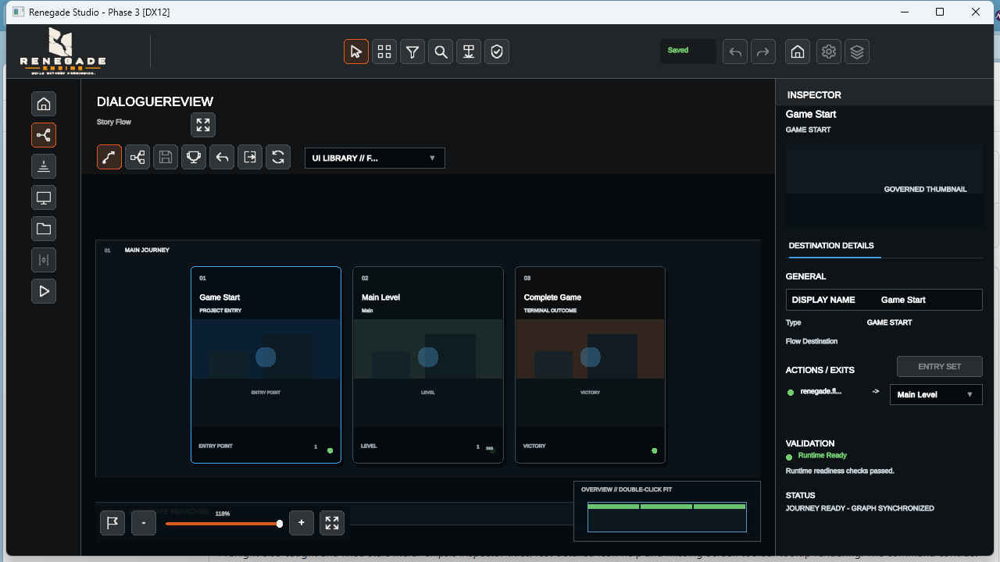
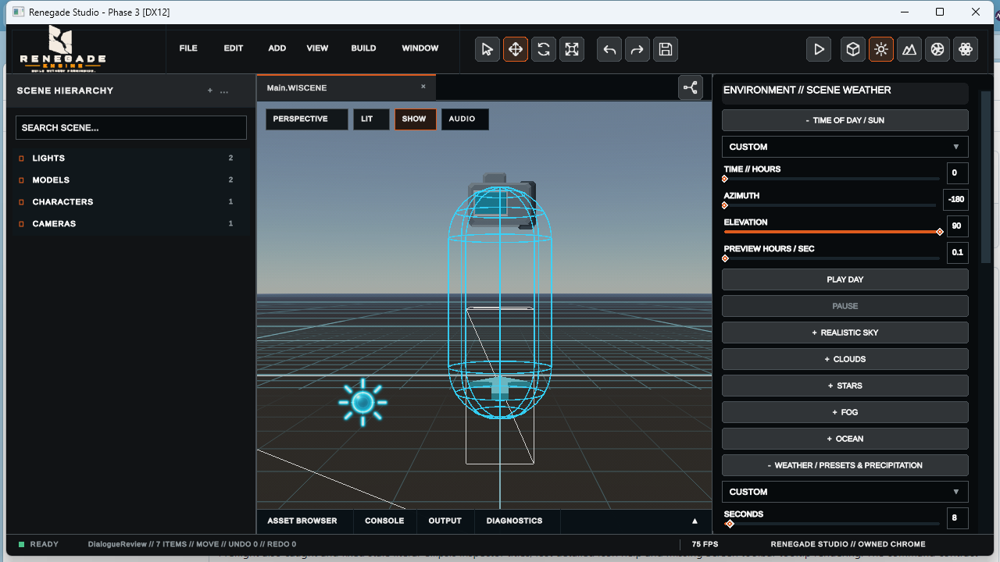
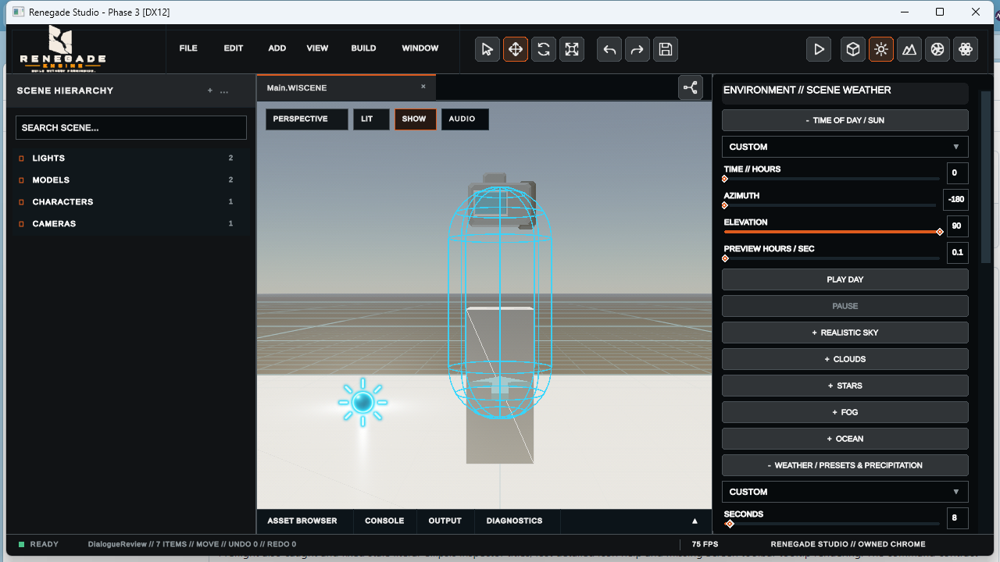
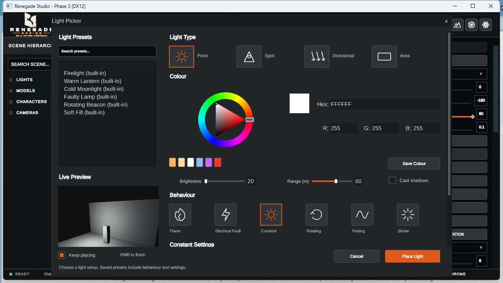
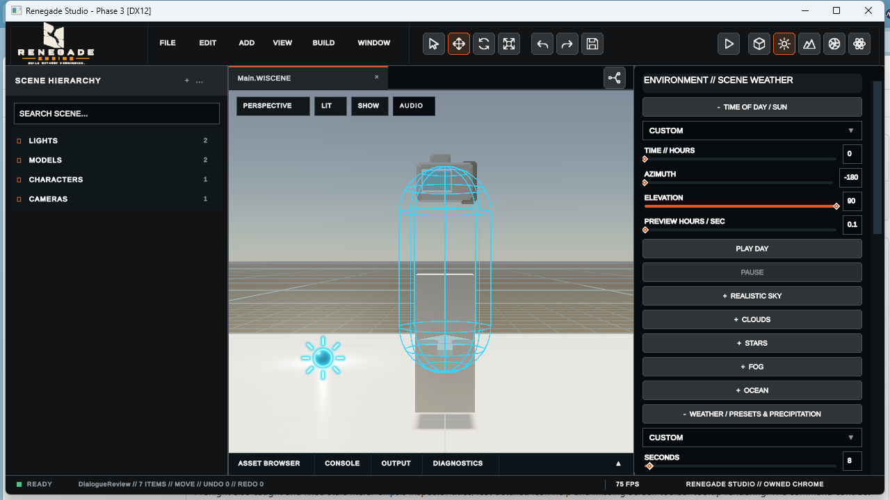

# PR #197 UMA/wireframe recovery evidence

Implementation: affe8d14ecde5e92302658368dc841b45c3f09e8. Configure stamp: 585407a; exact six corrective input hashes: [corrected-source-hashes.json](corrected-source-hashes.json).
[Scope/results](validation-summary.json) and [recovery receipt](../../UI_PR197_UMA_RECOVERY_20261117.md).

- Original hosted failures: [summary](original-ci-failures.json).
- Actual WARP unchanged allocator before: [exit/hash](before-native-warp.json), [stdout](before-native-warp.stdout.txt), [failure](before-native-warp.stderr.txt).
- Corrected WARP: [Debug](tests-fixed-warp-debug.log), [Release](tests-fixed-warp-release.log); separate allocator byte/alias probes and executable hashes are in after-native-warp-*.
- Composition: [rejected old generator](composition-before/configure-first.txt), [corrected cold](composition-fixed/configure-first.txt), [stable reconfigure](composition-fixed/configure-second.txt).
- [Source/help/policy](source-help-policy.log), [normal hardware allocator](after-native-hardware-release.stdout.txt), [normal native review/hash](hardware-native-reviewed.json).
- Build/configuration logs and the three invocation scripts are retained beside these receipts. Text logs are normalized to UTF-8, spaces for indentation and a single final newline; diagnostic content is retained.
- Native captures below were visually inspected. The private preview remains shaded over scene overlay mode; scene/history stay unchanged.

