# Projectile Weapons: Create Your First Arrow

> **Draft 0.3 — native end-to-end projectile workflow tested on DESIGN (13 October 2026).** In a clearly identified copy of the Bow Playground, we created and saved a new Arrow asset, applied it to the player, saved and reopened the scene and project, and fired it in Test Level. Evidence and screenshots are recorded below. The guide still requires creator review and separate testing of optional surface-type variations before publication.

## Goal

Create a reusable arrow projectile, connect it to a first-person weapon's firing action, align its launch with an animation, and test it in a level.

**You need:** An open project, a placed **Player Start**, a compatible first-person bow/weapon assembly, and an assigned launch-capable animation action. A projectile is not automatically a weapon.

## Step 1 — Open Weapon Firing

Select **Player Start** in your scene hierarchy (in the tested project it was under **Characters**). Open **STARTING EQUIPMENT**, then **WEAPON FIRING**. Inside **Weapon firing**, choose the correct **Weapon hand** (Primary hand or Off hand) and **Launch on** action. **Use the action your actual weapon is configured to fire with.** The existing Bow Playground bow used **Primary fire / use**; other charged setups may use **Release charged action**. Do not change this based solely on the weapon being a bow.

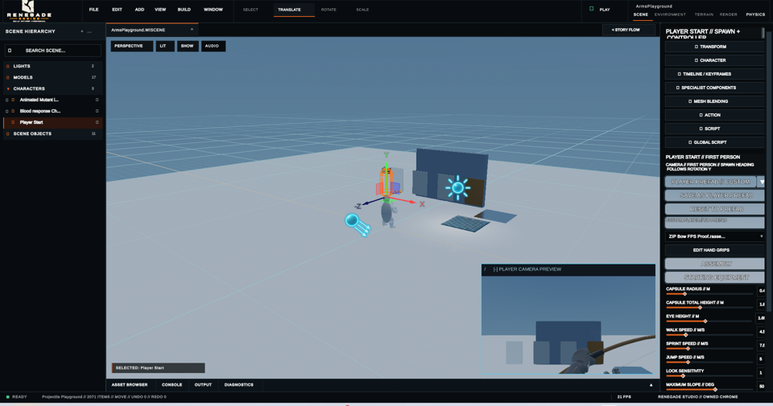

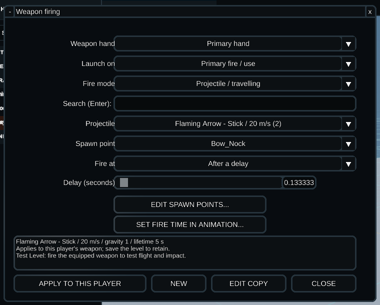

## Step 2 — Make an arrow

Set **Fire mode** to **Projectile / travelling**. Choose **NEW** to create a projectile or **EDIT COPY** to make a separate definition based on an existing one. **NEW initially opens the Bullet preset**: change the preset to **Arrow**, then give the projectile a readable name.

The **Basic** settings let you choose speed, gravity, appearance/model, scale and impact behaviour. **SHOW ADVANCED** reveals finer controls such as lifetime and model rotation. A preset is only a starting point, so you can change it. In particular, **Stick** requires an appropriate visible model, and a projectile should not be assumed to support homing, explosions or bouncing.

The Arrow preset initially uses **45 m/s** and **Gravity 1**; these are editable defaults, not required settings. It initially has **Visible model: None (flight feedback only)**. To see a physical arrow mesh, select or import a suitable model; **Stick into the object** requires one.

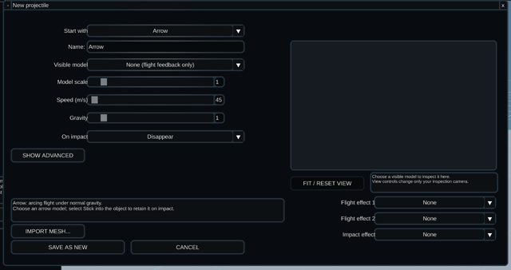

Select **SAVE AS NEW** to save the projectile definition, then choose that saved projectile in **Weapon firing**. The screenshot below shows the additional fields available under **SHOW ADVANCED**.

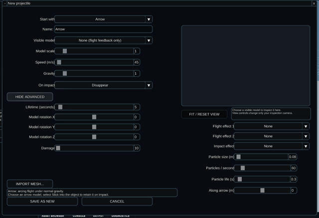

In the isolated QA copy, we selected the existing imported **Arrow** model, chose **Stick into the object**, named the new asset **Manual QA Arrow E2E** and clicked **SAVE AS NEW**. The Weapon firing dropdown then displayed the saved arrow at **45 m/s**:

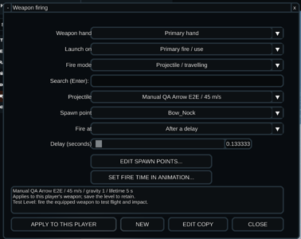

## Step 3 — Position the launch

Under **Spawn point**, choose a defined weapon launch point. Use the launch-point editor to make or adjust a point at the bow's nocking position. The tested bow example uses `Bow_Nock`, but your own point may be named differently.

A single available point can be used without changing **Firing**—that dropdown is normally hidden when only one spawn point is available. With two points configured, **Firing** offers **Selected spawn point**, **Alternate between two** and **Both together**.

## Step 4 — Set launch timing

Under **Fire at**, choose **Animation start** for an immediate shot or **After a delay** to wait for the firing animation. Use **SET FIRE TIME IN ANIMATION...** to open the preview, scrub to the release pose, select **MARK CURRENT POSE**, then **USE FIRE TIME** to transfer the chosen time into the firing setup. The selected action must have a valid preview, and the marker must occur before the end of its clip. In our live Bow Playground inspection, the existing saved fire marker was **0.133333 s** into a **0.833333 s** animation. These are **example asset values**, not recommended defaults. The preview was opened and then cancelled without applying changes.

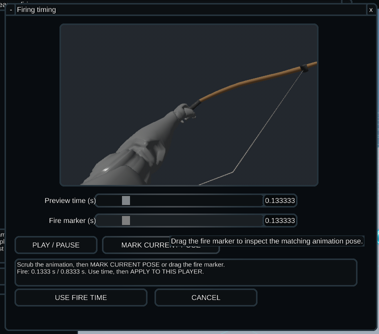

## Step 5 — Apply the weapon setup

Choose **APPLY TO THIS PLAYER**, then save the level with **Ctrl+S**. **Saving the projectile alone does not assign it to a weapon.** Applying creates an updated equipment definition for the selected Player Start; shared projectile assets and unrelated players should not be silently altered.

In the QA copy, applying the new arrow created a new equipment asset. After **File → Reopen Scene**, Weapon firing still displayed **Manual QA Arrow E2E**, **Bow_Nock**, **Primary fire / use** and the **0.133333-second** delay. We also returned to the Project Hub and reopened the QA project; Starting Equipment still referenced the newly created equipment asset.

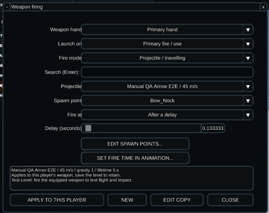

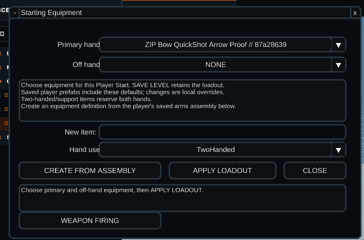

## Step 6 — Test the arrow

Use the **PLAY** control above the scene viewport to launch **Test Level**, then fire at an object. Confirm the arrow leaves at the intended animation time, flies correctly and responds to contact. In our isolated QA test, pressing the primary-fire mouse button animated the bow, produced a visible impact effect on the central target and left a dark retained projectile/impact mark on the panel. The mark remained on that target when the player moved sideways. Studio later reported **TEST LEVEL // COMPLETED**.

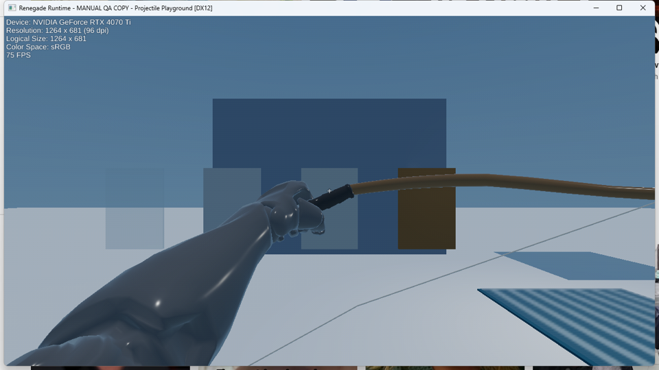

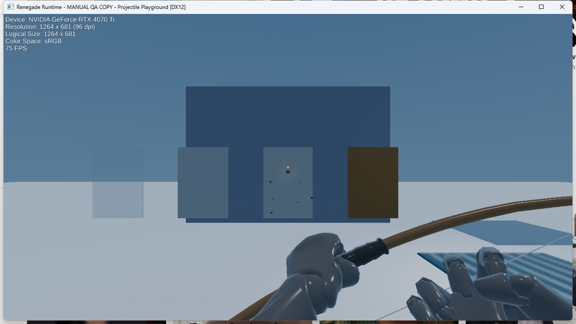

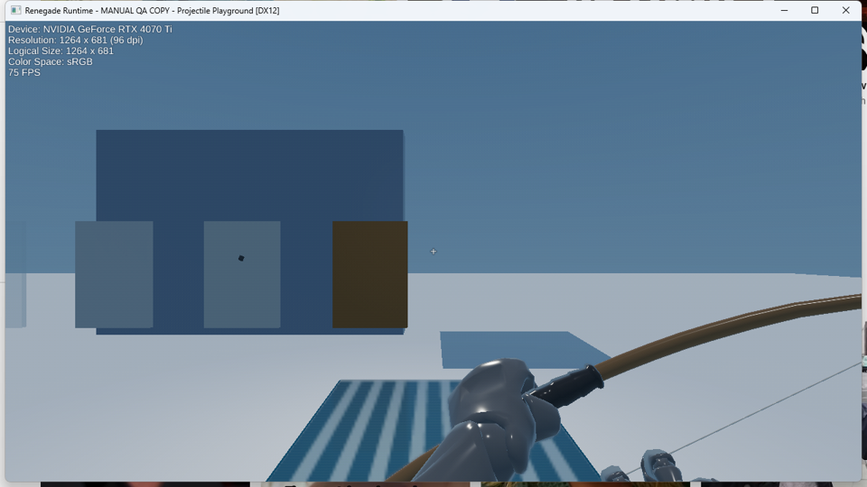

**Optional surface-type experiment (not part of this QA pass):** Change a target object's **Surface Type** in its Inspector (for example, Wood or Glass), then repeat the test to compare configured impact responses. Classifying a pane as Glass does **not** make it destructible.

## Quick troubleshooting

| Symptom | Check |
|---|---|
| No arrow launches | Is the action launch-capable, is the projectile selected, and did you choose **APPLY TO THIS PLAYER**? |
| Arrow appears at the camera | Check the authored **Spawn point** and its selection |
| Arrow launches early or late | Verify **Animation start / After a delay**, the release marker and the assigned animation |
| Stick doesn't work | Check for a suitable visible projectile model and supported impact behaviour |
| Impact looks or sounds wrong | Check target **Surface Type** and whether the relevant visual/audio effect is actually configured |
| Changes don't survive | Reopen equipment settings, reapply if necessary and save the level |

## Next topics

Hitscan / instant-ray fire mode; two launch points; projectile presets (Bullet, Arrow, Bolt, Thrown and Spell); impact visuals, decals and sound. These should become separate short chapters rather than cluttering this first tutorial.

## Source-of-truth references

- `Studio/src/PlayerEquipmentEditor.cpp`: WEAPON FIRING access
- `Studio/src/PlayerProjectileEditor.cpp`: authoring controls, spawn points and firing policies
- `docs/P3_PROJECTILE_UX_CLEANUP.md`: verified UI tests, timing preview and two-point mode
- `docs/P3_PROJECTILE_AUTHORING_UX.md`: equipment application and persistence
- `docs/CODEX_BOW_PROJECTILE_HANDOFF.md`: authored bow example
- `EngineBridge/include/renegade/bridge/ImpactSurface.h`: surface types

**Native QA receipt — 13 October 2026, DESIGN:** The initial read-only inspection and its five screenshots were followed by an isolated authoring run in `BUILD/manual-projectile-e2e-20261013/Bow-Playground.renegade`, labelled **MANUAL QA COPY – Projectile Playground** in Studio and Runtime. Fresh projectile ID: `c030b651-00c0-4af7-9827-3a29ed42e46e`; newly applied equipment asset ID: `87a28639-a59f-4bd4-b428-bb75ee82591a`. Source project and test copy started from the same scene file, and the original project's scene remained byte-for-byte unchanged after the QA save; only the isolated scene was modified. Reopening the saved scene and then the whole project retained the equipment binding. Test Level launched the correct copied project, animated the shot, showed impact feedback and a retained target mark, and exited normally. See `Tools/assistant_knowledge/MANUAL_E2E_STATUS.md` for the detailed result and limits.

**Publication gate:** This core workflow passed native QA in a **preconfigured bow project**, not a completely blank project. Optional Surface Type comparisons, a full creator usability review, polished annotation of screenshots, and exact integration-build verification remain outstanding. The chapter remains a **draft**, not final P3 gate acceptance.
